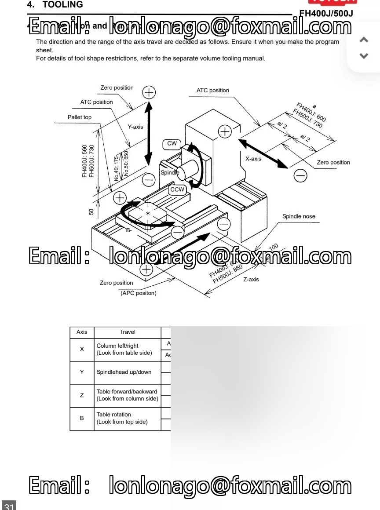
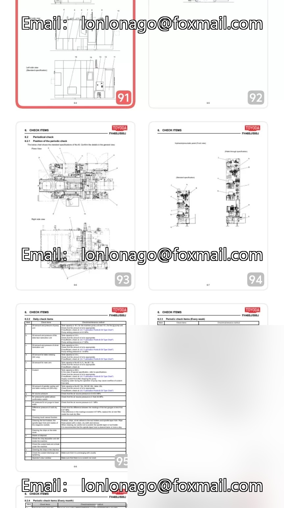

# JTEKT's Toyota Engineering Machines (TOYODA) FH400

## Body

JTEKT's Toyota Tool Company (TOYODA) FH400J/500J series machining center maintenance manual
PDF , 130 pages
Detailed content, suitable for equipment maintenance, inspection, and study reference.
Requires direct purchase, can communicate privately about issues.
3888

The maintenance manual covers the TOYODA FH400J/500J series machining center, including tooling, axis travel direction and range, positioning, coordinates, axis travel and displacement requirements.

<!-- AI_ENRICHED -->

## Images

## Payment

Here is a pay link on Stripe ( https://buy.stripe.com/3cs8yP7sY87d0vu9AB ). Please contact me lonlonago@foxmail.com after funding $89, and I will send you a complete data files , thank you!

